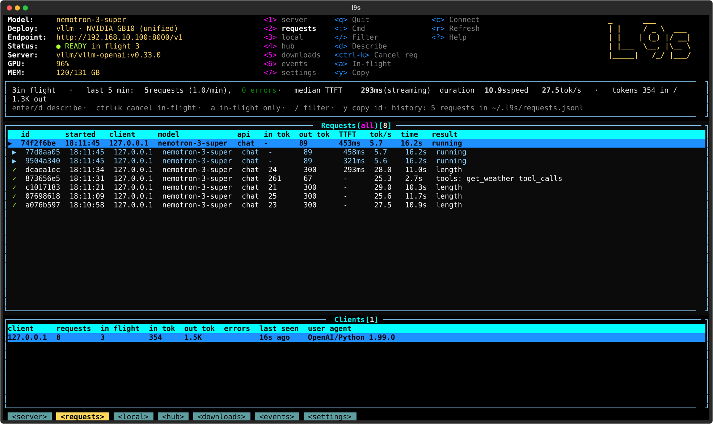
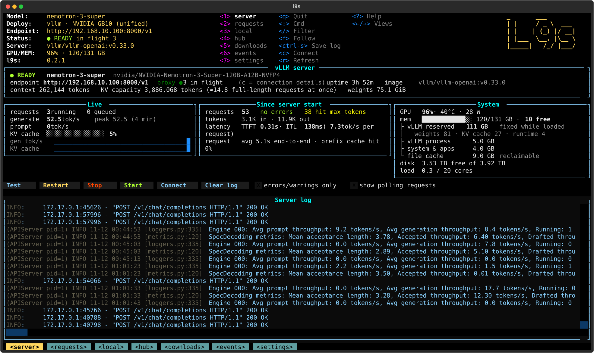
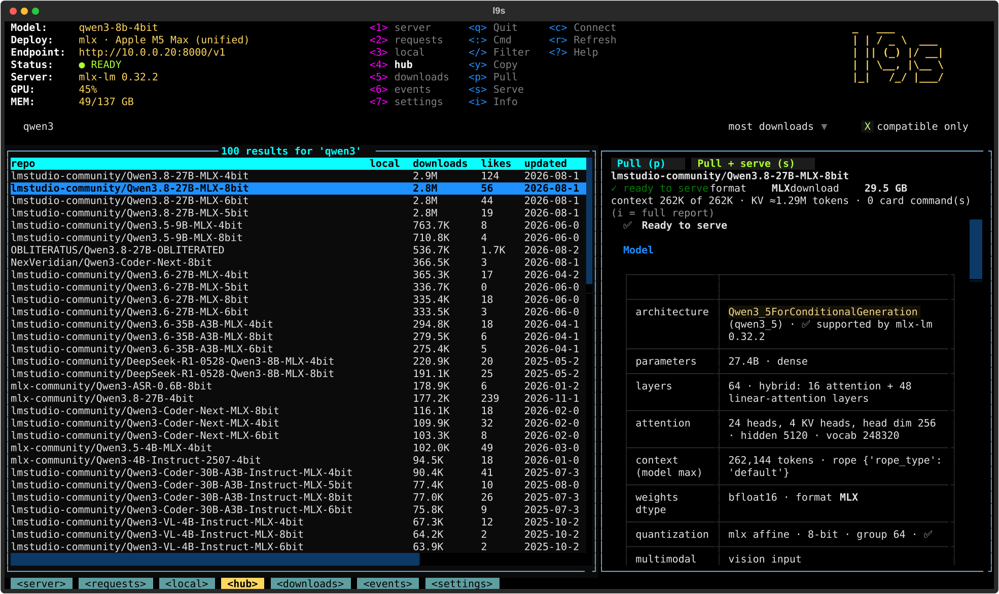
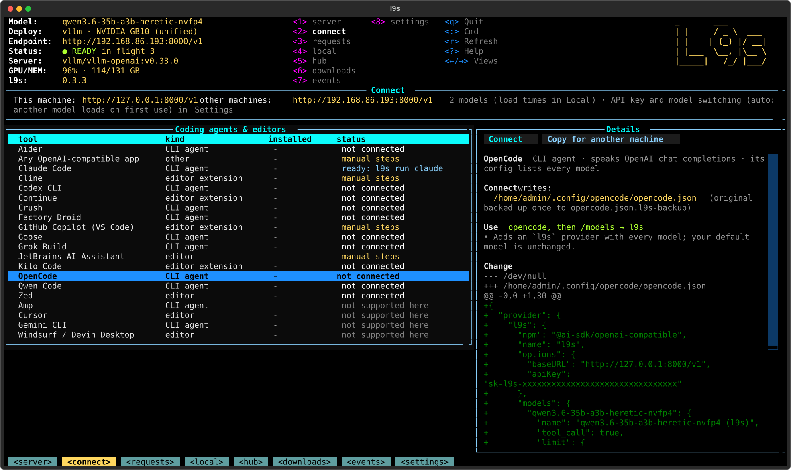

# l9s

**k9s for local LLMs.** l9s turns a GPU box or an Apple Silicon Mac into an OpenAI-compatible model server for
your network, and gives you a terminal UI to find, pull, serve and *watch* models: every request in flight,
throughput, latency, memory, startup progress, events.



```
clients ──▶ :8000  l9s-proxy ──▶ 127.0.0.1:8001  model server
              │  API key, request log,        ▲      vllm: vLLM in Docker (Linux + NVIDIA/AMD GPU)
              │  events, cancel               │      mlx:  mlx-lm server (Apple Silicon)
              ▼                               │
           l9s (TUI + CLI): analyze, pull, serve, switch, observe
```

## Deployments

The installer looks at the machine it runs on and installs only what that machine needs: on a Mac it installs
mlx-lm (no Docker, no vLLM, no sudo); on Linux with a GPU it installs vLLM in Docker. `l9s hw` shows what it detected.

| Deployment | Hardware | Model server | Status |
|---|---|---|---|
| **vllm** | Linux + NVIDIA GPU: unified-memory boxes (DGX Spark / GB10, Jetson Thor) and discrete GPUs (RTX, A/L/H/B-series), single or multi-GPU; amd64 and arm64 | [vLLM](https://github.com/vllm-project/vllm) in Docker | **tested** on an NVIDIA GB10 (Dell Pro Max GB10) |
| **mlx** | Macs with Apple Silicon (M1–M5) | [mlx-lm](https://github.com/ml-explore/mlx-lm) server under launchd | **tested** on an Apple M5 Max |
| vllm (AMD) | Linux + AMD Instinct/Radeon with ROCm | vLLM ROCm image | experimental, untested |

Discrete-GPU, multi-GPU and AMD support follow the same code paths (hardware detection, per-GPU memory math, tensor
parallel), but haven't been run on that hardware yet. Reports and fixes welcome.

## What you get

- **One OpenAI-compatible endpoint** with an API key, one model at a time, restarted automatically after a crash or
  reboot. Clients use the profile name as `model`, the same on both deployments.
- **Model analysis before you download** (`l9s info <repo>`, the Hub tab, the serve dialog). l9s reads the model's
  `config.json`, chat template, `generation_config.json` and model card, and checks them against what *your* server
  supports:
  - format and quantization (NVFP4, FP8, AWQ, GPTQ, MXFP4, MLX 4/8-bit…) and whether this server can load it
  - architecture support, MoE, multimodal, MTP layers, custom code
  - KV-cache bytes per token for full, sliding-window, hybrid Mamba / linear-attention and MLA models, giving
    **the context length that fits in memory** next to the weights, and how many full-length requests fit at once
  - tool-call / reasoning parsers from the model family and chat template (validated against vLLM's registry)
  - every `vllm serve` / `docker run` / `mlx_lm.server` command in the model card, preferring sections written for
    your hardware (e.g. "DGX Spark" on a GB10). Flags your server version doesn't have, parsers that don't exist,
    host/port settings and files on the author's machine are removed. Multi-GPU settings are fitted to your GPUs
  - presets (*Recommended* = card + computed fixes, *Computed only*, each card command), with the source of every flag
- **Smart downloads:** skips files the server never reads (GGUF, `.pth`, `original/`, duplicate `.bin`, TF/Flax).
  gpt-oss-20b: 41 GB → 14 GB. Speculative-decoding drafter models are pulled too.
- **Terminal UI** (`l9s`), k9s-style:
  - **Server:** state, startup phase and progress, last error, context and KV capacity, live tok/s, KV-cache
    sparklines, TTFT / inter-token latency / prefix-cache hits, memory breakdown (weights / KV cache / runtime),
    filterable log
  - **Requests:** every request in flight (▶) and recently finished, with client, model, tokens, TTFT, tok/s and
    finish reason. Describe a request (params, prompt and response preview), or **cancel it** (the server stops
    generating). Per-client usage
  - **Events:** server starts, exits, OOM kills, ready times, model switches, error bursts. Recorded even when the
    TUI is closed
  - **Local / Hub / Downloads / Settings:** profiles, Hugging Face search with fit estimates, background downloads,
    HF token (with check), API key, memory budget, port, server version (with release check)
  - `:` command bar · `/` filter (search, in the Hub) · `d` describe · `ctrl+k` cancel · `y` copy · `?` help
  - **arrow keys** everywhere: `←`/`→` switch views, `↑`/`↓` move through tables and on into the next table or field
  - **mouse-friendly:** every key hint in the header, the breadcrumbs, the header fields and the inline hints are
    clickable; table rows select on click

## Screenshots

**Server** (vLLM on a GB10): state, context and KV capacity, live throughput, latency, memory breakdown, server log.



**Hub** (mlx-lm on an Apple Silicon Mac): press `/` to search Hugging Face, see what fits and how to run it before
downloading.



## Install

One line, on the GPU box or Mac that will serve the model:

```bash
curl -fsSL https://raw.githubusercontent.com/JongoDB/l9s/main/get.sh | bash
```

That downloads l9s, installs it, and **starts serving a starter model** sized for the machine (the largest of
Qwen3 8B / 4B / 1.7B / 0.6B that fits with 16K+ context: FP8 builds for vLLM, 4-bit MLX builds on a Mac), so the
endpoint answers right away. Options go after `bash -s --`:

```bash
curl -fsSL https://raw.githubusercontent.com/JongoDB/l9s/main/get.sh | bash -s -- --model Qwen/Qwen3-4B-FP8
curl -fsSL https://raw.githubusercontent.com/JongoDB/l9s/main/get.sh | bash -s -- --no-model
```

Or from a clone: `git clone https://github.com/JongoDB/l9s.git && cd l9s && ./install.sh [--model <repo>|--no-model]`.

The installer detects your hardware and deployment, sets up [uv](https://github.com/astral-sh/uv) and a private Python
environment in `~/.l9s`, installs the `l9s` command, the request proxy as a service (systemd / launchd) and
the model server (vLLM image, or mlx-lm), generates an API key, and probes what the server supports. Running it again
updates l9s and keeps your settings, profiles and history (no starter model if you already have one).

**Linux (vllm) needs:** Docker with GPU access (`docker run --gpus all …` works: NVIDIA container toolkit, or ROCm),
and `sudo` for the `l9s` symlink and the proxy service.
**macOS (mlx) needs:** an Apple Silicon Mac; nothing else (no Docker, no sudo).

**Updates:** l9s checks once a day (and when the TUI opens). When a newer version is out, the TUI header shows
**↑ … available**: press `U` (or click it) to update and l9s restarts itself on the new version. From a shell,
`l9s update` does the same (`--check` only reports). In Settings → Updates you can switch to **auto** (installs
updates in the background without restarting a running model) or **off**. vLLM itself is never upgraded
automatically; when a newer release exists you're told the exact `l9s upgrade …` command.

**Releases and dependencies:** every Python package (Textual, aiohttp, huggingface_hub, and mlx-lm + MLX on a Mac)
is pinned to an exact version in `requirements.lock`, so an install or update always gets a CI-tested set. A weekly
GitHub Actions job re-resolves the lock to the newest versions; if anything changed it runs the full CI on Linux and
on an Apple Silicon runner (including a real mlx-lm server behind the proxy), and only when that passes does it bump
the patch version, write the changelog ("textual 8.2.8 → 8.3.0") and publish a release. `get.sh` and `l9s update`
install the latest release, not `main`. vLLM image bumps are tested by hand on GPU hardware: the job opens an issue
when a new vLLM release is out.

**Uninstall:** `l9s uninstall` removes the model server, the proxy service, the command and `~/.l9s`.
Downloaded models stay in the Hugging Face cache unless you add `--remove-models`; `--keep-config` keeps your
settings, profiles and history; `--remove-image` also deletes the vLLM Docker image.

## Quick start

```bash
l9s                                   # TUI: watch the server and requests; 4 = Hub, then / to search Hugging Face

l9s quickstart Qwen/Qwen3-8B-FP8      # pull + serve any model with its recommended settings
l9s info Qwen/Qwen3-8B-FP8            # just the analysis: does it fit, how much context, settings
l9s test
```

On a Mac, use MLX builds, e.g. `l9s quickstart mlx-community/Qwen3-8B-4bit`.

Point any OpenAI-compatible client at it:

```bash
export OPENAI_BASE_URL=http://<host>:8000/v1
export OPENAI_API_KEY=<output of: l9s key>
```

On a remote box, run the TUI over SSH: `ssh -t <host> l9s`.

## Use it with your coding agent

```bash
l9s claude                    # Claude Code on your local model (your normal `claude` is untouched)
l9s codex                     # Codex CLI
l9s connect opencode          # add l9s to OpenCode's config (shows the change, backs up the file, asks first)
l9s connect                   # every supported tool: installed? connected? how
```

Or press `8` (or `c`) in the TUI: the **Connect** view lists the tools, shows exactly what each one's setup would
change, and connects it with `enter`.



| Tool | How l9s sets it up | Checked against l9s |
|---|---|---|
| **Claude Code** | `l9s claude`: launches it with the right environment; writes nothing. `/model` lists every l9s model | ✅ vLLM and mlx, with tool calls |
| **Codex CLI** | adds an `l9s` provider + profile to `~/.codex`; `l9s codex` or `codex --profile l9s` | config from current docs |
| **OpenCode**, **Crush**, **Grok Build**, **Qwen Code**, **Goose**, **Factory Droid**, **Aider** | adds an `l9s` provider with every model (context and output limits filled in); `l9s run <tool>` launches it | config from current docs |
| **Kilo Code**, **Continue**, **Zed** | adds an `l9s` provider / models to the editor's config | config from current docs |
| **Cline**, **GitHub Copilot (VS Code)**, **JetBrains AI** | settings are GUI-only: the exact values to enter, step by step | n/a |
| **Cursor**, **Amp** | not possible: they send requests from their own cloud, which can't reach your network | n/a |

Every saved profile **and every downloaded model that fits** shows up as a model in these tools. Only one model is
loaded at a time: asking for another one **loads it on demand, like Ollama**. Requests already running finish
first, then the server is down while the new model loads (seconds on a Mac, often minutes for a big model on vLLM)
and every client waits. You always know what you're in for: model pickers show "loads on first use, last load took
~3 min", the TUI header shows `LOADING → model (1 min of ~3 min, asked by 192.168.1.20)` with a notification, and
streaming clients get keep-alives so they don't time out. Turn it off in Settings (Model switching) to get an error
instead.

Claude Code and Codex speak the Anthropic and OpenAI Responses APIs: vLLM serves them natively, and on a Mac the
proxy translates them to mlx-lm (tool calls included). Your tools on another machine: `l9s connect <tool> --server
<ssh-host>` there (with l9s installed), or copy the snippet from the Connect view. Configs that list models are
updated automatically when you add or remove profiles; `l9s connect <tool> --remove` takes l9s back out.

## CLI

| Command | |
|---|---|
| `l9s` | terminal UI |
| `l9s quickstart [repo]` | pull and serve a model with its recommended settings (no repo: starter model that fits) |
| `l9s info <repo>` | model analysis and recommended serve command |
| `l9s pull <repo>` | download (skips files the server doesn't use; `--include/--exclude` to override) |
| `l9s serve <repo> [--name N] [--env K=V]... [server flags]` | save a profile and switch the server to it |
| `l9s use <profile>` · `l9s profiles` | switch to / list profiles |
| `l9s status` · `l9s logs [-f]` · `l9s test` | health, server log, test request |
| `l9s stop` · `start` · `restart` | control the model server |
| `l9s ls` · `l9s rm <repo>` | downloaded models / delete weights |
| `l9s proxy status\|restart\|logs` | the request proxy |
| `l9s upgrade <image:tag>` | (vllm) switch vLLM version |
| `l9s connect [tool] [--remove\|--print\|--server host]` | set up Claude Code, Codex, OpenCode, Zed, … to use l9s |
| `l9s claude` · `l9s codex` · `l9s run <tool> [-m model]` | launch a coding agent on l9s without changing its normal setup |
| `l9s hw` · `l9s key` | detected hardware / API key |
| `l9s update [--check] [-y]` | check for / install a newer l9s (and mlx-lm on a Mac) |
| `l9s uninstall [-y] [--keep-config] [--remove-models] [--remove-image]` | remove l9s |

Full reference: [docs/USAGE.md](docs/USAGE.md).

## Example: what reading the model card is worth

On a GB10, Nemotron-3-Super-120B-A12B-NVFP4 with hand-picked vLLM flags ran at **16.5 tok/s**. l9s's
*Recommended* preset took the card's "vLLM on DGX Spark" command, removed what vLLM 0.33 no longer accepts
(`--swap-space`, a reasoning-parser plugin file, multi-GPU settings), capped the context to what fits, and kept its MTP
speculative decoding. The result was **26–30 tok/s** with a 262K context (single request, same machine).

## How it works

| Path | |
|---|---|
| `get.sh` | one-line installer: downloads a release and runs `install.sh` |
| `install.sh` | installer (both deployments); `--model <repo>` / `--no-model` |
| `bin/l9s` | CLI (bash): profiles, serve/switch, pull, quickstart, status, uninstall; drives Docker (vllm) or launchd (mlx) |
| `app/tui.py` | terminal UI ([Textual](https://github.com/Textualize/textual)) |
| `app/hfmeta.py` | model analysis: Hub metadata, memory and KV math, card command extraction and sanitizing, presets |
| `app/hw.py` | hardware detection: vendor, GPUs, unified vs dedicated memory, Docker GPU flags, live GPU stats |
| `app/updater.py` | update checks: l9s (GitHub), mlx-lm (PyPI), vLLM releases (Docker Hub); cached daily |
| `app/proxy.py` | request-tracking reverse proxy ([aiohttp](https://github.com/aio-libs/aiohttp)): API key, model list, on-demand model loading, event recorder |
| `app/translate.py` | Anthropic Messages and OpenAI Responses ⇄ chat completions, for mlx-lm (tool calls and streaming) |
| `app/connect.py` · `app/tools.py` | `l9s connect` / `l9s run`: safe config merges (backup, only l9s' own entries) and each tool's setup |
| `app/vllm_caps.py` / `app/mlx_caps.py` | ask the installed server which flags, architectures, parsers and quant methods it supports |
| `requirements.in` / `requirements.lock` | allowed ranges / exact pinned versions (`uv pip compile --universal`) |
| `.github/workflows/` | `ci.yml` (Linux + Apple Silicon MLX), `deps.yml` (weekly lock refresh → release), `release.yml` (tag on `VERSION` change) |
| `tests/unit/` | fast tests run in CI: model analysis math, updater, proxy against a mock server, real mlx-lm on Apple Silicon |
| `tests/live/` | end-to-end tests that drive the real TUI and proxy against a live server (some switch models: run them on a box you can interrupt) |

State lives in `~/.l9s` (config `env`, `profiles/`, `requests.jsonl`, `events.jsonl`, `logs/`); model weights stay
in the standard Hugging Face cache, shared with other tools.

## Privacy

Everything stays on your machine. The proxy keeps the first ~400 characters of each prompt and response in
`~/.l9s/requests.jsonl` (mode 600) so the Requests view can show them; turn that off in Settings (`LOG_PROMPTS=0`).

## License

MIT
