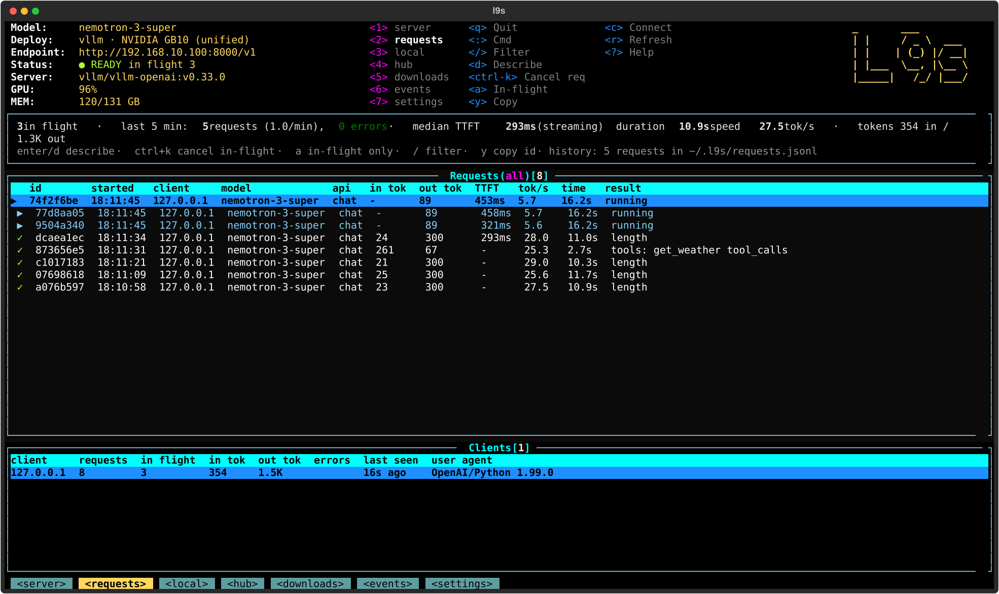
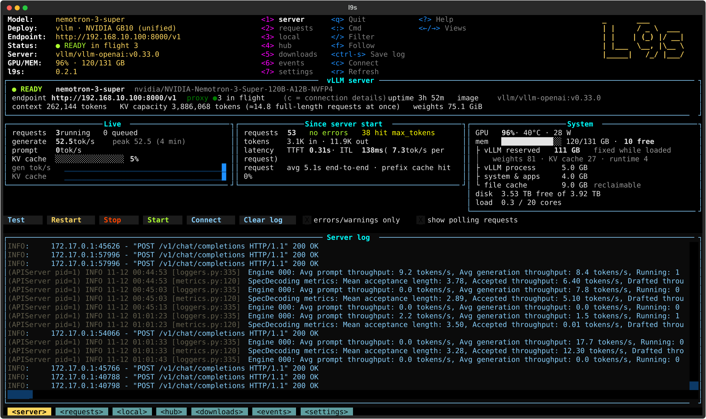
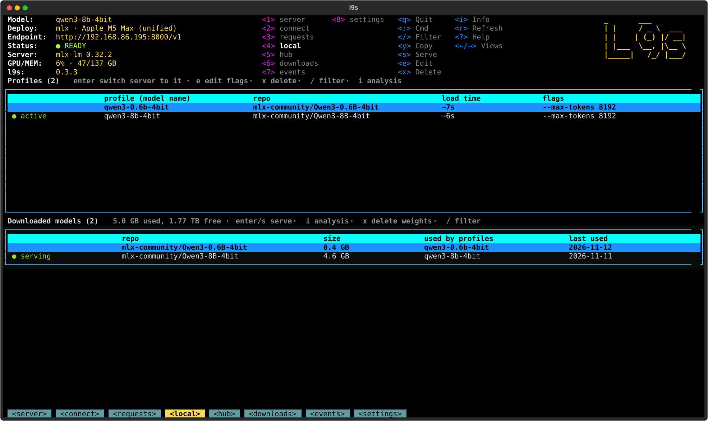
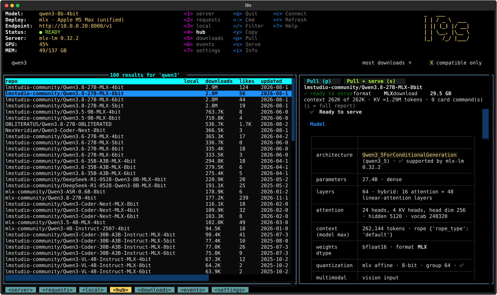
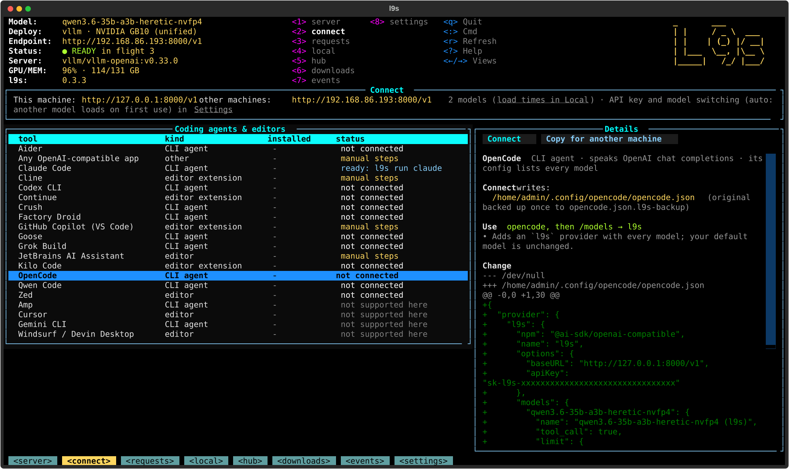

# l9s

**k9s for local LLMs.** l9s turns a GPU box or an Apple Silicon Mac into an OpenAI-compatible model server for
your network, and gives you a terminal UI to find, pull, serve and *watch* models: every request in flight,
throughput, latency, memory, startup progress, events.



```
clients ──▶ :8000  l9s-proxy ──▶ 127.0.0.1:8001  model server
              │  API key, request log,        ▲      vllm: vLLM in Docker (Linux + NVIDIA/AMD GPU)
              │  events, cancel               │      mlx:  mlx-lm server (Apple Silicon)
              ▼                               │
           l9s (TUI + CLI): analyze, pull, serve, switch, observe
```

## Deployments

The installer looks at the machine it runs on and installs only what that machine needs: on a Mac it installs
mlx-lm (no Docker, no vLLM, no sudo); on Linux with a GPU it installs vLLM in Docker. `l9s hw` shows what it detected.

| Deployment | Hardware | Model server | Status |
|---|---|---|---|
| **vllm** | Linux + NVIDIA GPU: unified-memory boxes (DGX Spark / GB10, Jetson Thor) and discrete GPUs (RTX, A/L/H/B-series), single or multi-GPU; amd64 and arm64 | [vLLM](https://github.com/vllm-project/vllm) in Docker | **tested** on an NVIDIA GB10 (Dell Pro Max GB10) |
| **mlx** | Macs with Apple Silicon (M1–M5) | [mlx-lm](https://github.com/ml-explore/mlx-lm) server under launchd | **tested** on an Apple M5 Max |
| vllm (AMD) | Linux + AMD Instinct/Radeon with ROCm | vLLM ROCm image | experimental, untested |
| vllm (WSL2) | Windows + NVIDIA GPU, through WSL2 | vLLM in Docker | experimental, untested |
| **client** | any machine (Linux, macOS, WSL2), no GPU needed | none: uses linked l9s servers | **tested** on a MacBook (M5) using a GB10 |

Discrete-GPU, multi-GPU and AMD support follow the same code paths (hardware detection, per-GPU memory math, tensor
parallel), but haven't been run on that hardware yet. Reports and fixes welcome.

## What you get

- **One endpoint for every API your tools speak:** OpenAI chat and completions, the OpenAI Responses API (Codex) and
  the Anthropic Messages API (Claude Code), with an API key, one model at a time. Clients use the profile name as
  `model`, the same on both deployments; asking for another model loads it on demand.
- **Everything in the app, nothing to edit by hand:** every setting is in the TUI (Settings) and the CLI
  (`l9s config`), from one list, so the two always agree, and both check a value before saving it. Settings
  migrate themselves on update.
- **Looks after itself:**
  - **Health checks:** `l9s doctor` and the Health panel run continuously and offer a **Fix** for each problem
    (server down, out of memory, disk, certificate, tunnel, firewall, keys being guessed, linked servers, updates).
  - **Alerts:** to your phone or chat (ntfy, Slack, Discord, any webhook) when the server goes down, its public
    address changes or a certificate is about to expire.
  - **Self-healing:**
    - the server is restarted after a crash or reboot;
    - requests that arrive during a restart wait for it instead of failing;
    - a model whose context doesn't fit is lowered to what vLLM measured and started again.
  - **Backups:** taken before every risky change, kept 10 deep, restored from Settings or `l9s restore`.
  - **Bug reports:** `l9s report` makes one file to attach to a bug report, with keys, tokens and prompts removed.
- **Share it safely:** a key per person with limits, and an HTTPS address on your network, your VPN, a free
  Cloudflare address, Tailscale or your own domain, which l9s sets up and detects for you (see
  [Share it](#share-it-one-server-many-people)). Or link other people's servers and use their models as your own.
- **Model analysis before you download** (`l9s info <repo>`, the Hub tab, the serve dialog). l9s reads the model's
  `config.json`, chat template, `generation_config.json` and model card, and checks them against what *your* server
  supports:
  - format and quantization (NVFP4, FP8, AWQ, GPTQ, MXFP4, MLX 4/8-bit…) and whether this server can load it
  - architecture support, MoE, multimodal, MTP layers, custom code
  - KV-cache bytes per token for full, sliding-window, hybrid Mamba / linear-attention and MLA models, giving
    **the context length that fits in memory** next to the weights, and how many full-length requests fit at once
  - tool-call / reasoning parsers from the model family and chat template (validated against vLLM's registry)
  - every `vllm serve` / `docker run` / `mlx_lm.server` command in the model card, preferring sections written for
    your hardware (e.g. "DGX Spark" on a GB10). Flags your server version doesn't have, parsers that don't exist,
    host/port settings and files on the author's machine are removed. Multi-GPU settings are fitted to your GPUs
  - presets (*Recommended* = card + computed fixes, *Computed only*, each card command), with the source of every flag
- **Smart downloads:** skips files the server never reads (GGUF, `.pth`, `original/`, duplicate `.bin`, TF/Flax).
  gpt-oss-20b: 41 GB → 14 GB. Speculative-decoding drafter models are pulled too.
- **Terminal UI** (`l9s`), k9s-style:
  - **Server:** state, startup phase and progress, last error, context and KV capacity, live tok/s, KV-cache
    sparklines, TTFT / inter-token latency / prefix-cache hits, memory breakdown (weights / KV cache / runtime),
    filterable log
  - **Requests:** every request in flight (▶) and recently finished, with client, model, tokens, TTFT, tok/s and
    finish reason. Describe a request (params, prompt and response preview), or **cancel it** (the server stops
    generating). Per-client usage
  - **Events:** server starts, exits, OOM kills, ready times, model switches, error bursts. Recorded even when the
    TUI is closed
  - **Local / Hub / Downloads:** profiles, Hugging Face search with fit estimates, background downloads
  - **Connect / Keys / Settings:** coding-agent setup, per-person keys and usage, and every setting: mode, access,
    API key, HF token (with check), memory budget, ports, model switching, speculative decoding, alerts, updates,
    backups, Report a problem
  - **Health** (click the badge in the header, or `:doctor`): every check, with Fix buttons
  - `:` command bar · `/` filter (search, in the Hub) · `d` describe · `ctrl+k` cancel · `y` copy · `?` help
  - **arrow keys** everywhere: `←`/`→` switch views, `↑`/`↓` move through tables and on into the next table or field
  - **mouse-friendly:** every key hint in the header, the breadcrumbs, the header fields and the inline hints are
    clickable; table rows select on click

## Screenshots

**Server** (vLLM on a GB10): the header (always on screen) has the model, status, endpoint and memory; the view adds
context and KV capacity, live throughput, latency, the memory breakdown and the server log.



**Local** (mlx-lm on a Mac): profiles with how long each took to load, so you know what a switch will cost, and the
downloaded weights.



**Hub** (mlx-lm on an Apple Silicon Mac): press `/` to search Hugging Face, see what fits and how to run it before
downloading.



## Three ways to use it

| Mode | For | What l9s sets up |
|---|---|---|
| **personal** | a GPU box or Apple Silicon Mac that serves **you** | the model server, tuned for one conversation at a time; your tools on this machine and your LAN / VPN |
| **shared** | a server for **many people** | the model server tuned for many at once, HTTPS (`l9s expose`: Let's Encrypt via Caddy, Cloudflare Tunnel, Tailscale) and a key per person with limits |
| **client** | any machine that should **use someone else's l9s** | no model server: link their server with the URL + key they gave you; its models show up for every tool on this machine as `<link>/<model>` |

The first time you open `l9s` it asks which one; change it any time in Settings › Mode or with `l9s mode`.
Linking works in every mode, so a personal server can add a friend's models next to its own. A machine without a
GPU l9s can use (an Intel Mac, a laptop) installs as a client.

```bash
# client: use a server someone shared with you
curl -fsSL https://raw.githubusercontent.com/JongoDB/l9s/main/get.sh | bash -s -- --mode client \
  --link gb1 https://llm.example.com sk-l9s-their-key-for-you
l9s claude      # Claude Code on gb1's model (gb1/l9s: whatever gb1 has loaded)
```

## Install

One line, on the GPU box or Mac that will serve the model:

```bash
curl -fsSL https://raw.githubusercontent.com/JongoDB/l9s/main/get.sh | bash
```

That downloads l9s, installs it and opens a short **setup**:

1. **Mode:** personal, shared or client.
2. **Reach:** how people reach the server; l9s detects your LAN and VPN addresses.
3. **Model:** one recommended model for your hardware, with its download size and the speed measured on that
   hardware.
4. **Keys:** your API key.

The recommended models are Qwen3.6-35B-A3B on a GB10 / DGX Spark (NVFP4 with its DFlash drafter, ~97 tokens/s) or on a
Mac with enough memory (MLX 4-bit, ~113 tokens/s on a 128 GB M-series), otherwise the largest Qwen3 that fits.
A non-interactive install (scripts, CI) skips the setup and serves that model straight away. Options go after
`bash -s --`:

```bash
curl -fsSL https://raw.githubusercontent.com/JongoDB/l9s/main/get.sh | bash -s -- --model Qwen/Qwen3-4B-FP8
curl -fsSL https://raw.githubusercontent.com/JongoDB/l9s/main/get.sh | bash -s -- --no-model
```

Or from a clone: `git clone https://github.com/JongoDB/l9s.git && cd l9s && ./install.sh [--model <repo>|--no-model]`.
`--mode personal|shared|client` picks the mode without asking (an interactive install asks); `--link <name> <url>
<key>` links a server right away.

The installer detects your hardware and deployment, sets up [uv](https://github.com/astral-sh/uv) and a private Python
environment in `~/.l9s`, installs the `l9s` command, the request proxy as a service (systemd / launchd) and
the model server (vLLM image, or mlx-lm), generates an API key, and probes what the server supports. Running it again
updates l9s and keeps your settings, profiles and history (no starter model if you already have one).

**Linux (vllm) needs:** Docker with GPU access (`docker run --gpus all …` works: NVIDIA container toolkit, or ROCm),
and `sudo` for the `l9s` symlink and the proxy service.
**macOS (mlx) needs:** an Apple Silicon Mac; nothing else (no Docker, no sudo).

**Updates:** l9s checks once a day (and when the TUI opens). When a newer version is out, the TUI header shows
**↑ … available**: press `U` (or click it) to update and l9s restarts itself on the new version. From a shell,
`l9s update` does the same (`--check` only reports). In Settings → Updates you can switch to **auto** (installs
updates in the background without restarting a running model) or **off**, and pick the **stable** or **beta**
channel. Every update takes a backup first. vLLM itself is never upgraded automatically; when a newer release
exists you're told the exact `l9s upgrade …` command.

**Releases and dependencies:** every Python package (Textual, aiohttp, huggingface_hub, and mlx-lm + MLX on a Mac)
is pinned to an exact version in `requirements.lock`, so an install or update always gets a tested set. A weekly
GitHub Actions job re-resolves the lock to the newest versions. If anything changed and CI passes, it bumps the
patch version and writes the changelog ("textual 8.2.8 → 8.3.0"), and the release goes through the same path as
every other release: the hardware gate on real machines, a beta, then stable (see
[Releases](#releases-platforms-and-compatibility)). `get.sh` and `l9s update` install the latest release, not
`main`. vLLM image bumps are tested by hand on GPU hardware: the job opens an issue when a new vLLM release is out.

**Uninstall:** `l9s uninstall` removes the model server, the proxy service, the update and tunnel services and
the command. Your settings, keys, linked servers, profiles and history stay (and a backup is taken), so a reinstall
picks up where you left off; `--purge` removes them too. Downloaded models stay in the Hugging Face cache unless you
add `--remove-models`; `--remove-image` also deletes the vLLM Docker image.

## Quick start

```bash
l9s                                   # TUI: watch the server and requests; 5 = Hub, then / to search Hugging Face

l9s quickstart Qwen/Qwen3-8B-FP8      # pull + serve any model with its recommended settings
l9s info Qwen/Qwen3-8B-FP8            # just the analysis: does it fit, how much context, settings
l9s test
```

On a Mac, use MLX builds, e.g. `l9s quickstart mlx-community/Qwen3-8B-4bit`.

Point any OpenAI-compatible client at it:

```bash
export OPENAI_BASE_URL=http://<host>:8000/v1
export OPENAI_API_KEY=<output of: l9s key>
```

On a remote box, run the TUI over SSH: `ssh -t <host> l9s`.

## Use it with your coding agent

```bash
l9s claude                    # Claude Code on whatever l9s has loaded, following your switches (normal `claude` is untouched)
l9s codex                     # Codex CLI
l9s connect opencode          # add l9s to OpenCode's config (shows the change, backs up the file, asks first)
l9s connect                   # every supported tool: installed? connected? how
```

Or press `2` (or `c`) in the TUI: the **Connect** view lists the tools, shows exactly what each one's setup would
change, and connects it with `enter`.



| Tool | How l9s sets it up | Checked against l9s |
|---|---|---|
| **Claude Code** | `l9s claude`: launches it with the right environment; writes nothing. `/model` lists your l9s models (not Claude's), and the model knows it isn't Claude | ✅ vLLM and mlx, with tool calls |
| **Codex CLI** | adds an `l9s` provider + profile to `~/.codex`; `l9s codex` or `codex --profile l9s`. `/model` lists your l9s models (l9s serves Codex's model catalog) | config from current docs |
| **OpenCode**, **Crush**, **Grok Build**, **Qwen Code**, **Goose**, **Factory Droid**, **Aider** | adds an `l9s` provider with every model (context and output limits filled in); `l9s <tool>` launches it (`l9s opencode`, `l9s goose`, …) | config from current docs |
| **Kilo Code**, **Continue**, **Zed** | adds an `l9s` provider / models to the editor's config | config from current docs |
| **Cline**, **GitHub Copilot (VS Code)**, **JetBrains AI** | settings are GUI-only: the exact values to enter, step by step | n/a |
| **Cursor**, **Amp** | not possible: they send requests from their own cloud, which can't reach your network | n/a |

Every saved profile **and every downloaded model that fits** shows up as a model in these tools. Only one model is
loaded at a time: asking for another one **loads it on demand, like Ollama**. Requests already running finish
first, then the server is down while the new model loads (seconds on a Mac, often minutes for a big model on vLLM)
and every client waits. You always know what you're in for: model pickers show "loads on first use, last load took
~3 min", the TUI header shows `LOADING → model (1 min of ~3 min, asked by 192.168.1.20)` with a notification, and
streaming clients get keep-alives so they don't time out. Turn it off in Settings (Model switching) to get an error
instead.

**Follow what's loaded, or pin a model.** The first model in every list is `l9s`: it means "whatever l9s has loaded"
and never triggers a switch. `l9s claude`, `l9s codex` and the other launchers start on it, so when you switch
models in the TUI an open session just uses the new one on its next message. (Its context limit is the smallest of
your models, so it fits whichever is loaded.) Pick a specific model (`l9s claude -m <model>`, or by name in a
picker) and that session asks for it by name: if you switch away, its next request switches back. Before you
switch, the TUI and `l9s use` tell you which clients would do that.

Claude Code and Codex speak the Anthropic and OpenAI Responses APIs: vLLM serves them natively, and on a Mac the
proxy translates them to mlx-lm (tool calls included). Your tools on another machine: `l9s connect <tool> --server
<ssh-host>` there (with l9s installed), or copy the snippet from the Connect view. Configs that list models are
updated automatically when you add or remove profiles; `l9s connect <tool> --remove` takes l9s back out.

## Share it: one server, many people

```bash
l9s expose cloudflare               # a free https://….trycloudflare.com address (no account, nothing to open)
l9s expose cloudflare --host llm.example.com   # or: your domain on Cloudflare (browser login or --api-token)
l9s expose caddy llm.example.com    # or: your domain, Let's Encrypt certificate via Caddy (ports 80/443 open)
l9s expose tailscale [--private]    # or: Tailscale Funnel (public) / your tailnet only
l9s expose vpn                      # or: only your VPN (l9s finds this machine's VPN address)
l9s expose lan                      # or: your local network
l9s keys add alice --concurrent 2   # a key per person; shown once, stored as a hash
l9s keys usage                      # who used how much
```

The setup that opens the first time you run `l9s` asks how people reach the server (this machine only, your
network, a VPN, a free temporary address, Tailscale, or your own domain), and Settings › Access changes it later; l9s
detects the addresses itself (`l9s expose --help` lists every choice). l9s itself speaks plain HTTP, so it never goes
on the internet directly: the internet choices put an HTTPS front end with a real certificate in front of it. Each person gets their own
key, which you can rate-limit (requests per minute, requests at once), restrict to certain models, and revoke
instantly. By default other people's keys use whatever model is loaded and can't switch it (only you, or keys you
allow, can make the server load another model). vLLM batches everyone's requests together, so a GB10 serves one
person at ~110 tokens/s and 32 at once at ~550 tokens/s in total. The **Keys** view (9) shows each key's usage
today; the Requests view shows who sent what. Someone with l9s installed connects with
`l9s connect --server https://llm.example.com --key <their key>`, and every `l9s claude` / `l9s connect <tool>`
then uses your server.

A server with no API key only answers this machine: l9s won't open it to other devices. Keys are stored as hashes,
someone guessing keys is blocked and shows up in Health, and the admin API only answers on the machine itself.

**Link servers.** `l9s link add gb10 https://llm.example.com --key <key>` adds another l9s server's models to
yours as `gb10/<model>`, in every tool on this machine; a machine in client mode has only linked models.

## CLI

| Command | |
|---|---|
| `l9s` | terminal UI |
| `l9s quickstart [repo]` | pull and serve a model with its recommended settings (no repo: starter model that fits) |
| `l9s info <repo>` | model analysis and recommended serve command |
| `l9s pull <repo>` | download (skips files the server doesn't use; `--include/--exclude` to override) |
| `l9s serve <repo> [--name N] [--env K=V]... [server flags]` | save a profile and switch the server to it |
| `l9s use <profile>` · `l9s profiles` | switch to / list profiles |
| `l9s status` · `l9s logs [-f]` · `l9s test` | health, server log, test request |
| `l9s stop` · `start` · `restart` | control the model server |
| `l9s ls` · `l9s rm <repo>` | downloaded models / delete weights |
| `l9s proxy status\|restart\|logs` | the request proxy |
| `l9s upgrade <image:tag>` | (vllm) switch vLLM version |
| `l9s connect [tool] [--remove\|--print\|--server host]` | set up Claude Code, Codex, OpenCode, Zed, … to use l9s |
| `l9s claude` · `l9s codex` · `l9s <tool> [-m model]` | launch a coding agent on l9s without changing its normal setup |
| `l9s config [list\|get\|set\|reset]` | every setting, the same ones as the TUI's Settings |
| `l9s mode [personal\|shared\|client]` · `l9s expose …` | who it's for / how people reach it |
| `l9s keys [add\|set\|revoke\|rm\|usage]` · `l9s link [add\|rm]` | per-person keys / linked servers |
| `l9s doctor [--fix]` · `l9s alerts [test]` | health checks with fixes / where alerts go |
| `l9s backup` · `l9s restore [id]` | back up / restore your setup |
| `l9s report [--anonymize] [--issue]` | one file for a bug report, secrets removed |
| `l9s hw` · `l9s key` | detected hardware / API key |
| `l9s update [--check] [-y]` | check for / install a newer l9s (and mlx-lm on a Mac) |
| `l9s uninstall [-y] [--purge] [--remove-models] [--remove-image]` | remove l9s (your setup stays for a reinstall unless `--purge`) |

Full reference: [docs/USAGE.md](docs/USAGE.md).

## Example: what reading the model card is worth

On a GB10, Nemotron-3-Super-120B-A12B-NVFP4 with hand-picked vLLM flags ran at **16.5 tok/s**. l9s's
*Recommended* preset took the card's "vLLM on DGX Spark" command, removed what vLLM 0.33 no longer accepts
(`--swap-space`, a reasoning-parser plugin file, multi-GPU settings), capped the context to what fits, and kept its MTP
speculative decoding. The result was **26–30 tok/s** with a 262K context (single request, same machine).

## How it works

| Path | |
|---|---|
| `get.sh` | one-line installer: downloads a release and runs `install.sh` |
| `install.sh` | installer (both deployments); `--model <repo>` / `--no-model` |
| `bin/l9s` | CLI (bash): profiles, serve/switch, pull, quickstart, status, uninstall; drives Docker (vllm) or launchd (mlx) |
| `app/tui.py` | terminal UI ([Textual](https://github.com/Textualize/textual)) |
| `app/hfmeta.py` | model analysis: Hub metadata, memory and KV math, card command extraction and sanitizing, presets |
| `app/hw.py` | hardware detection: vendor, GPUs, unified vs dedicated memory, Docker GPU flags, live GPU stats |
| `app/updater.py` | update checks: l9s (GitHub), mlx-lm (PyPI), vLLM releases (Docker Hub); cached daily |
| `app/proxy.py` | request-tracking reverse proxy ([aiohttp](https://github.com/aio-libs/aiohttp)): API key, model list, on-demand model loading, event recorder |
| `app/translate.py` | Anthropic Messages and OpenAI Responses ⇄ chat completions, for mlx-lm (tool calls and streaming) |
| `app/connect.py` · `app/tools.py` | `l9s connect` / `l9s <tool>`: safe config merges (backup, only l9s' own entries) and each tool's setup |
| `app/registry.py` · `app/config.py` · `app/envfile.py` | the one list of settings (checks, defaults, what each change restarts) behind Settings, `l9s config` and the docs; config migrations |
| `app/expose.py` · `app/mode.py` | how people reach the server (LAN, VPN, Cloudflare, Tailscale, Caddy, your own proxy) / personal, shared, client |
| `app/keys.py` · `app/links.py` | per-person keys and limits / linked servers |
| `app/doctor.py` · `app/alerts.py` · `app/backup.py` · `app/report.py` | health checks and fixes / alerts / backups and restore / bug-report file |
| `app/vllm_caps.py` / `app/mlx_caps.py` | ask the installed server which flags, architectures, parsers and quant methods it supports |
| `requirements.in` / `requirements.lock` | allowed ranges / exact pinned versions (`uv pip compile --universal`) |
| `.github/workflows/` | `ci.yml` (Linux, Apple Silicon MLX, Caddy + ACME), `release.yml` (on a `VERSION` change: CI → hardware gate → beta), `hardware.yml` (the live suite on a GB10 and a Mac), `promote.yml` (beta → stable after 3 days), `deps.yml` (weekly lock refresh) |
| `tests/unit/` | fast tests run in CI: model analysis math, updater, proxy against a mock server, real mlx-lm on Apple Silicon |
| `tests/live/` | end-to-end tests that drive the real TUI and proxy against a live server (the hardware gate runs them; some switch models: run them on a box you can interrupt) |

State lives in `~/.l9s` (config `env`, `profiles/`, `keys.json`, `links.json`, `requests.jsonl`, `events.jsonl`,
`logs/`) and backups in `~/.l9s-backups`; model weights stay in the standard Hugging Face cache, shared with other
tools.

## Releases, platforms and compatibility

**Platforms.** *Supported* means tested on real hardware before every release: NVIDIA GB10 / DGX Spark, NVIDIA
GPUs on Linux (single and multi-GPU) and Apple Silicon Macs. *Experimental* means expected to work but not tested on
real hardware: AMD ROCm and NVIDIA on WSL2. Any other machine can use l9s in *client mode* (other people's l9s
servers). `l9s hw` says which this machine is; the installer and the TUI header say so too.

**Releases.** Every release first passes CI and then the hardware gate: the full live test suite (the TUI, the
setup, the API, Claude Code and Codex sessions) on a GB10 and a Mac, started only once each machine has been idle
for 15 minutes so it never interrupts anyone using them. It ships as a **beta**, and becomes **stable**
after 3 days with no open `regression` issue. New installs and automatic updates get stable. Settings › Updates
(`l9s config set UPDATE_CHANNEL beta`) gets betas when you update by hand.

**Compatibility (from 1.0).** Versions follow semantic versioning. Within 1.x, settings, `l9s` commands and their
flags, the API that tools connect to, and the files l9s keeps (config, keys, links, backups) stay compatible:
- an update never needs you to change anything;
- a renamed setting is migrated for you;
- something that goes away is announced in the changelog and in `l9s doctor` at least one minor release before it's
  removed.

## Privacy

Everything stays on your machine: l9s sends no telemetry. The proxy keeps the first ~400 characters of each prompt
and response in `~/.l9s/requests.jsonl` (mode 600) so the Requests view can show them; turn that off in Settings
(`LOG_PROMPTS=0`). `l9s report` writes a file you attach yourself, with keys, tokens, prompts and replies removed
(`--anonymize` also replaces host names and addresses). Alerts go only to the webhook you set.

## License

MIT
